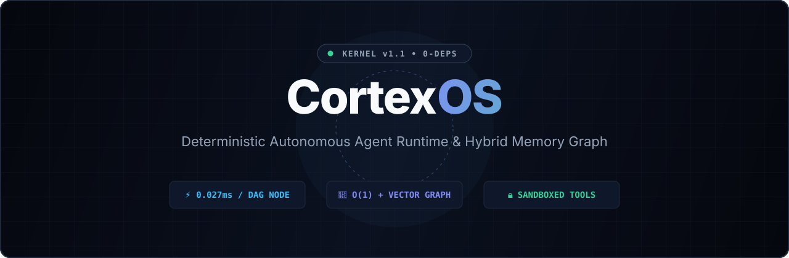

<div align="center">



<br />

[](https://github.com/shashwajenakinapelly/CortexOS/actions/workflows/ci.yml)
[](https://github.com/shashwajenakinapelly/CortexOS/releases)
[](#)
[](#)
[](LICENSE)

**The ultra-low-latency, zero-dependency kernel for autonomous AI agents.**  
*Deterministic DAG orchestration • Hybrid O(1) + Vector Memory Graph • Sandboxed Tool Execution*

[Architecture](#-system-architecture) • [Quickstart](#-quickstart) • [Telemetry CLI](#-live-telemetry-cortex-top) • [Benchmarks](#-verified-benchmarks) • [Roadmap](#-roadmap)

</div>

---

## ⚡ Why CortexOS?

Most AI agent frameworks wrap simple LLM calls in 40+ heavy dependencies, introducing hundreds of milliseconds of overhead and unpredictable execution loops. **CortexOS** treats agent orchestration like an operating system kernel:

| Capability | Legacy Agent Frameworks | **CortexOS Kernel** |
| :--- | :--- | :--- |
| **Execution Model** | Unbounded recursive loops | **Deterministic Topological DAG (`O(V+E)`)** |
| **Runtime Dependencies** | 25–50+ external packages | **0 (100% Native Node.js / TypeScript)** |
| **Memory Architecture** | External vector DB required | **Embedded Hybrid KV + Cosine Vector Graph** |
| **Fault Tolerance** | Crashes on transient tool errors | **Per-node Exponential Backoff & Timeout Sandbox** |
| **Observability** | Heavy cloud telemetry SaaS | **Built-in ANSI Terminal Monitor (`npm run top`)** |

---

## 🏗 System Architecture

```mermaid
flowchart TB
    subgraph Input["1. Ingress & Planning"]
        A[Goal / Task Graph] --> B{Topological Cycle Validator}
    end

    subgraph Kernel["2. CortexOS Execution Kernel"]
        B -->|Valid DAG| C[Bounded Concurrency Scheduler]
        C <--> D[(Hybrid Memory Graph\nO(1) KV + 64-dim Cosine)]
        C <--> E[Sandboxed Tool Registry\nTimeout & Isolation]
        C <--> F[Local / Cloud LLM Adapter\nOllama • OpenAI Compatible]
    end

    subgraph Telemetry["3. Deterministic Output"]
        C --> G[Exponential Backoff Retry Engine]
        G --> H[Verified Execution Report & Metrics]
    end
```

---

## 🚀 Quickstart

Clone, verify tests, run the live terminal telemetry monitor, and execute the benchmark suite in under 30 seconds:

```bash
git clone https://github.com/shashwajenakinapelly/CortexOS.git
cd CortexOS
npm install
npm test
npm run top
```

### Complete Agent Example (DAG + Memory + Sandboxed Tools)

```typescript
import { CortexEngine, MemoryGraph, ToolRegistry } from "./src/index.js";

// 1. Initialize persistent hybrid memory
const memory = new MemoryGraph({ persistence: "./data/cortex.json" });
memory.upsert("policy-sec", "All shell executions must pass AST boundary verification.");

// 2. Register sandboxed tools with strict execution timeouts
const tools = new ToolRegistry().register({
  name: "scan-ast",
  description: "Analyzes module dependency graph",
  execute: async ({ target }: { target: string }) => ({ target, status: "clean", riskScore: 0.01 }),
});

// 3. Configure deterministic DAG runtime
const engine = new CortexEngine({
  model: "local:llama-3-8b",
  memory,
  maxConcurrency: 8,
  maxRetries: 2,
});

// 4. Execute parallel & dependent agent tasks
const report = await engine.executeGraph([
  {
    id: "recall-policy",
    run: async ({ memory }) => memory.query("AST boundary security policy", 1)[0],
  },
  {
    id: "run-security-scan",
    run: async () => tools.invoke("scan-ast", { target: "src/core/engine.ts" }, 2000),
  },
  {
    id: "final-decision",
    dependencies: ["recall-policy", "run-security-scan"],
    run: async ({ results }) => ({
      approved: true,
      policy: results["recall-policy"],
      scan: results["run-security-scan"],
    }),
  },
]);

console.log(report);
```

---

## 🖥 Live Telemetry (`cortex top`)

Inspect active DAG nodes, concurrency utilization, per-step latency, and RSS memory directly in your terminal:

```bash
npm run top
```

```text
╔══════════════════════════════════════════════════════════════════════╗
║  ⚡ CORTEX-OS KERNEL TELEMETRY (cortex top)         [STATUS: ACTIVE]  ║
╚══════════════════════════════════════════════════════════════════════╝

[████████████████████] 100% | Node: output-guardrail       | Latency: 45.41ms | RSS: 71.2MB
✔ All DAG execution pipelines verified. Memory Graph Nodes: 6
```

---

## 📊 Verified Benchmarks

Reproducible locally via `npm run bench` (Ubuntu Linux, Node.js runtime, 0 external dependencies):

| Benchmark Operation | Scale | Total Time | Per-Op Latency |
| :--- | :--- | :--- | :--- |
| **Sequential DAG Task Resolution** | 1,000 interdependent nodes | **27.42 ms** | **0.0274 ms / task** |
| **Hybrid Vector + KV Indexing** | 5,000 memory nodes | **66.01 ms** | **0.0132 ms / node** |
| **Cosine Similarity Top-5 Search** | 5,000-node corpus (64-dim) | **38.81 ms** | **38.81 ms / query** |

> **Peak Process RSS Memory:** `74.62 MB` (including V8 runtime overhead). Run `npm run bench` to reproduce on your hardware.

---

## 🗺 Roadmap

- [x] **v1.0.0** — Core asynchronous DAG execution engine with $O(V+E)$ cycle detection
- [x] **v1.0.0** — Hybrid key-value & cosine-similarity vector memory graph
- [x] **v1.1.0** — Sandboxed tool registry, native Ollama LLM provider & `cortex top` CLI monitor
- [ ] **v1.2.0** — Native `node:sqlite` high-volume storage backend (>1M nodes)
- [ ] **v2.0.0** — WebAssembly (WASM) isolate runtime for untrusted third-party agent plugins

---

## 🤝 Contributing

We welcome high-signal pull requests. Read [`CONTRIBUTING.md`](CONTRIBUTING.md) and explore [`good first issue`](https://github.com/shashwajenakinapelly/CortexOS/issues) tasks to get started.

## 📄 License

Distributed under the MIT License. See [`LICENSE`](LICENSE) for details.
